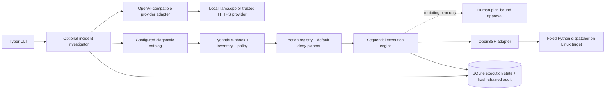

# Architecture

## Components

- **Schema/config:** safe YAML loader rejects duplicate keys; Pydantic models reject unknown fields and unsupported schema versions. Inventory, policy, SSH profiles, and runbooks are separate files.
- **Planner:** expands only exact `$param.name` references, verifies registered action names and argument schemas, resolves target aliases, and evaluates explicit host policy. It hashes the runbook and all config sources and stores a plan before execution.
- **Action registry:** maps a small set of action IDs to fixed implementations. Runbooks cannot pass shell text, executable paths, environment assignments, or Python modules.
- **SSH adapter:** uses OpenSSH with a dedicated identity, strict host key checking, an explicit user `known_hosts` file, a fixed SSH option set, no agent forwarding/proxy/password authentication, and bounded timeouts. It does not use sudo or retry.
- **Remote dispatcher:** receives base64 JSON describing one registered action, validates its fields again, and invokes a fixed argument vector with `subprocess` (never a shell). Target-side requirements are Python 3 and standard Linux utilities.
- **Execution engine:** runs preflight, steps, and postflight sequentially. Pre/postflight are read-only by schema. A failed or uncertain step stops the run. An uncertain SSH result is never automatically retried.
- **SQLite store:** persists plans, approvals, executions, step evidence, investigations, and a sequential SHA-256 audit chain. Database and parent state directory are restricted to the current OS user.

## AI investigation boundary

- The optional investigator makes two bounded model requests: select catalog IDs, then assess evidence. It does not expose the model to the SSH adapter or arbitrary action arguments.
- A catalog ID maps locally to a runbook file. The selected runbook is planned again by the core engine. Every planned action must be registered, read-only, explicitly allowed for its target, and within configured action-call and execution-time budgets.
- The engine creates execution IDs and stores each step result. Investigation records link to those executions. “Verified evidence” is generated from successful engine steps; hypotheses and recommendations remain separate and cite existing evidence references.
- Recommendations are strings for a human operator. They are never converted to a plan or executed. Remediation remains subject to the existing approval path.
- Incident text and bounded evidence are sent to the configured provider. Raw incident text is not stored in investigation history. Configure only a provider appropriate for that data; the local provider should bind to loopback.

## Data flow and trust boundaries

The local operator controls source/config files, the SQLite DB, and the private key. Remote hosts are trusted only after the host key is pinned. Policy file changes invalidate saved plans. The remote shim is fixed package code; the request payload is JSON and is base64 encoded for safe OpenSSH transport. No user-supplied value is interpreted as a shell command.

Model output, incident descriptions, and SSH evidence are untrusted. The model's diagnostic selection is parsed into a strict schema and checked against the local catalog. Unknown IDs, remediation, and unsupported evidence citations are denied. Schema validation does not make model-generated hypotheses facts.
